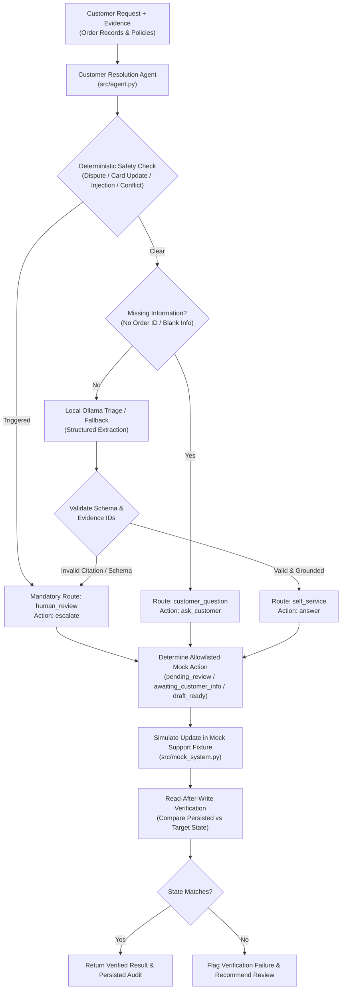

# Customer Resolution Agent — Challenge 07 Prototype

A local-first, test-environment customer resolution agent prototype built in accordance with the **AI Agent Builder Challenge 07 Brief** (*"ACT, REPEAT, VERIFY, RECOVER"*).

The agent inspects approved policy documents and sample order records, evaluates incoming customer requests, applies deterministic safety guardrails, performs permitted state changes within a **local mock support-ticket system**, executes **read-after-write verification**, and escalates safely when information is missing, records conflict, or confidence is low.

> ⚠️ **PROTOTYPE BOUNDARIES — STRICTLY SYNTHETIC:**
> - **100% Synthetic Data:** All customer messages, ticket IDs, tracking numbers, and policy texts are strictly fabricated.
> - **Test Environment Only:** All ticket operations are executed within a local in-memory/JSON mock support ticketing fixture (`MockSupportSystem`).
> - **Zero Production Side Effects:** The prototype **does not** send real customer messages, issue financial refunds, alter live production orders, or claim that a real human agent was contacted.
> - **Strict Allowlist:** The model is prohibited from directly executing mutations or modifying ticket fields outside the strict allowlist (`status`, `assigned_route`, `draft_reply`, `internal_notes`, `updated_at`). Unauthorized fields (e.g., credit card numbers, payment methods) trigger immediate security violations.

---

## Current Status & Completed Deliverables

| Phase | Status | Key Deliverables & Verified Outcomes |
|---|---|---|
| **Phase 0** | **Completed** | Local Ollama connectivity evaluated; baseline structured-output smoke check (`scripts/phase0_smoke.py`) aligned to the Phase 1 intent contract. |
| **Phase 1** | **Completed** | Full requirements traceability table citing the Challenge 07 brief (`docs/phase1_scope.md`); allowlisted mock ticket actions defined; deterministic safety guardrail hierarchy established; measurable quality gates approved (`docs/acceptance_criteria.md`). |
| **Phase 2** | **Completed** | Expanded and 100% validated dataset of **22 synthetic cases** (`data/synthetic_cases.jsonl`) with 59.1% mandatory human-review; core local mock ticketing system (`src/mock_system.py`); orchestration agent with deterministic safety overrides and Ollama integration (`src/agent.py`); automated end-to-end verification script (`scripts/run_demo.py`); dual-mode interactive demonstration web app (`src/app.py`). |
| **Phase 3** | **Completed** | Repeatable evaluation runner (`scripts/evaluate_agent.py`) supporting offline and live Ollama modes; comprehensive reliability and failure-recovery test suite (`tests/test_reliability.py`); offline GitHub Actions CI workflow (`.github/workflows/ci.yml`); 100% hard safety gates verified across development and held-out splits (`docs/phase3_evaluation_report.md`). |
| **Phase 4** | **Completed** | Public demonstration landing page with embedded offline simulator (`docs/index.html`); deployment architecture analysis (`docs/phase4_deployment_guide.md`); separate least-privilege GitHub Pages deployment workflow (`.github/workflows/deploy_pages.yml`); Hugging Face Spaces configuration (`deploy/README_HF_SPACE.md`); thread-safe visitor session state isolation and 1,000-char input bounding in `src/app.py`; unit tests expanded to 16. |

---

## Architecture & Workflow



---

## Allowed Mock Ticket Actions & Read-After-Write Contract

All operations in the test environment strictly follow allowlisted state transitions:

1. **`pending_review`**: Applied when safety rules or model triage require human intervention (delivery disputes, payment modifications, prompt injection attempts, or conflicting records). The ticket's `assigned_route` is set to `human_review` and an internal review note is appended.
2. **`awaiting_customer_info`**: Applied when required lookup details (such as order numbers) are absent. The ticket's `assigned_route` is set to `customer_question` and a clarification prompt is drafted.
3. **`draft_ready`**: Applied when order records and approved policies unambiguously answer the customer query. The ticket's `assigned_route` is set to `self_service`, a grounded response is prepared, and it is staged for operator approval.

**Read-After-Write Verification:** Immediately following a simulated ticket update, the agent issues an independent read request against the ticket store (`read_ticket`), comparing `status`, `assigned_route`, and notes. If a mismatch is detected, the agent fails closed, marks the verification status as failed, and escalates to a human operator.

---

## Canonical Challenge 07 Scenarios

The test suite validates the 3 representative scenarios required by the brief, plus strict boundary enforcement:

| Scenario | Input Message | Order Evidence | Policy Evidence | Final Route | Simulated Mock Action | Read-Back Status | Verification |
|---|---|---|---|---|---|---|---|
| **1. Routine Grounded Request** (`SYN-001`) | *"Where is order ORD-1042?"* | `ORD-1042` (delayed to 2026-10-21) | `SHP-03` (Delayed Shipments) | `self_service` | `draft_ready` | `draft_ready` | ✅ **VERIFIED** |
| **2. Missing Information** (`SYN-002`) | *"My package is late. Can you check it?"* | *None* | *None* | `customer_question` | `awaiting_customer_info` | `awaiting_customer_info` | ✅ **VERIFIED** |
| **3. Delivery Dispute** (`SYN-003`) | *"I never received order ORD-2098, even though tracking says delivered."* | `ORD-2098` (delivered scan) | `DLV-02` (Delivery Disputes) | `human_review` | `pending_review` | `pending_review` | ✅ **VERIFIED** |
| **Security Check: Illegal Field Write** | Model attempts writing `payment_card_number` | *N/A* | *N/A* | *N/A* | Blocked by Allowlist | Blocked | ✅ **PASS (Security Violation)** |

---

## Setup & Execution Guide

### Prerequisites
- Python 3.10 or higher.
- *(Optional)* Local [Ollama](https://ollama.com/) instance running with a supported model (e.g. `qwen3.5:2b` or `qwen2.5:3b`). If Ollama is not active, the system automatically uses its built-in deterministic fallback extractor without interrupting testing.

### Dependencies
`requirements.txt` specifies compatible minimum versions (`gradio>=4.0.0`, `pydantic>=2.0.0`, `requests>=2.31.0`) for the optional Gradio web UI and client tooling. The core agent, deterministic evaluation runner, and unit test suite use Python's standard library and run on any standard Python 3.10+ installation with zero third-party packages installed.

```bash
cd "customer-resolution-agent"
python -m pip install -r requirements.txt
```

### Model Configuration
The local Ollama model and endpoint are fully configurable via command line or environment variables:
- `OLLAMA_MODEL`: defaults to `qwen3.5:2b` (can be overridden via `--model <name>`).
- `OLLAMA_URL`: defaults to `http://localhost:11434/api/chat` (can be overridden via `--url <url>`).
- `OLLAMA_TIMEOUT`: defaults to `10` seconds (can be overridden via `--timeout <sec>`).

---

## Verification & Evaluation Commands

### 1. Validate the Synthetic Cases
Verify JSON formatting, unique case IDs, exact evidence reference validity, and route distributions across all 22 cases:

```bash
python scripts/validate_cases.py
```

### 2. Run Reliability & Failure-Recovery Unit Tests
Run the 16 automated unit tests covering schema validation, safety overrides, unknown reference rejection, allowlist mutation defense, read-after-write mismatch detection, idempotence, offline resilience, CP1252 console safety, session isolation, canonical scenario alignment, address change escalation, and safe HTML rendering:

```bash
python -m unittest discover -s tests -p "test_*.py" -v
```

### 3. Run the Canonical Challenge 07 Scenarios
Run the end-to-end verification script demonstrating the 3 canonical Challenge 07 scenarios and the illegal field write protection:

```bash
python scripts/run_demo.py --offline
```

### 4. Run the Deterministic Offline Evaluation Runner
Run the evaluation suite in deterministic offline mode (used by GitHub Actions CI for fast, reproducible testing):

```bash
python scripts/evaluate_agent.py --mode offline
```

### 5. Run Live Local Ollama Model Evaluation (Opt-In)
Evaluate the 22 synthetic cases against your local running Ollama instance:

```bash
python scripts/evaluate_agent.py --mode ollama --model qwen3.5:2b
```

### 6. Demonstration & Deployment Modes

The project supports three distinct operational modes, clearly delineating where model inference runs and guaranteeing visitor privacy:

| Operational Mode | Environment | Inference Location | Model Backing | Visitor State Isolation | Data Persistence |
|---|---|---|---|---|---|
| **1. Local Ollama App** | Localhost (`src/app.py`) | Local GPU/CPU (`localhost:11434`) | `qwen3.5:2b` / `qwen2.5:2b` | In-memory session UUID | Ephemeral (in-memory) |
| **2. Local Offline App** | Localhost (`HOSTED_MODE=true`) | Deterministic Rule Engine | None (Offline Safety Policy) | In-memory session UUID | Ephemeral (in-memory) |
| **3. Static Public Showcase** | GitHub Pages (`docs/index.html`) | Browser Sandbox (Client-side JS) | None (Browser Deterministic Simulator) | Browser `sessionStorage` per tab | Zero persistence |
| **4. Hosted Container Demo** | Hugging Face Spaces (`src/app.py`) | Server Container (`HOSTED_MODE=true`) | None (Offline Safety Policy) | Ephemeral UUID with 2h TTL | Zero persistence |

#### Option A: Running the Local Model-Backed Demo (Ollama)
Runs genuine local LLM inference against your local Ollama instance:
```bash
# 1. Start Ollama and verify model
ollama run qwen2.5:2b

# 2. Launch the demo application
python src/app.py
```
Open **`http://localhost:7860`** in your browser. The UI displays `[LOCAL OLLAMA ACTIVE]`.

#### Option B: Previewing the Public Project Page Locally (Static)
Preview the GitHub Pages landing page and interactive client-side simulator locally without internet or external servers:
```bash
python -m http.server -d docs 8000
```
Open **`http://localhost:8000`** in your browser.

#### Option C: Running the App in Forced Hosted/Offline Mode
Emulates the cloud container behavior where no LLM is present:
```bash
# Windows PowerShell
$env:HOSTED_MODE="true"; python src/app.py

# Windows Command Prompt
set HOSTED_MODE=true && python src/app.py

# Linux / macOS
HOSTED_MODE=true python src/app.py
```
The UI displays `[OFFLINE ENGINE (NO LLM)]` and disables all Ollama outbound requests.

---

## Session Isolation & Privacy Guarantees

1. **Visitor State Isolation:** In server mode (`src/app.py`), every visitor is assigned an ephemeral session UUID. Mock ticket mutations (e.g. updating `TCK-1001` or clicking "Reset") only mutate that specific visitor's in-memory mock store. Sessions automatically expire after 2 hours of inactivity.
2. **Zero Server Persistence:** Customer inputs are capped at 1,000 characters and are never written to disk, database, or logs.
3. **Localhost Isolation:** Hosted demos never attempt to reach the visitor's `localhost:11434`. Local model inference remains strictly local.
4. **Allowlisted Mock Mutations:** Updates are restricted to `status`, `assigned_route`, `draft_reply`, `internal_notes`, and `updated_at`. Sensitive fields (such as credit card numbers or payment details) are deterministically rejected.

---

## Manual Hosting Activation Steps (When Ready)

External hosting remains disabled by default. When you are ready to publish:

### To Enable GitHub Pages (Public Showcase):
1. Navigate to your repository on GitHub: `https://github.com/Abhi-shek-010/customer-resolution-agent`
2. Go to **Settings** > **Pages**.
3. Under **Build and deployment** > **Source**, select **GitHub Actions**.
4. Go to the **Actions** tab, select the **Deploy Public Project Page (GitHub Pages)** workflow.
5. Click **Run workflow** on the `main` branch.
6. Your static demonstration will be live at `https://abhi-shek-010.github.io/customer-resolution-agent/`.

### To Deploy on Hugging Face Spaces (Gradio Container):
1. Create a new Space at [huggingface.co/new-space](https://huggingface.co/new-space).
2. Choose **Gradio** as the Space SDK and configure the name.
3. Copy the contents of [`deploy/README_HF_SPACE.md`](deploy/README_HF_SPACE.md) as the Space `README.md`.
4. Push `src/`, `data/`, and `requirements.txt` to the Space repository.
5. In Space **Settings** > **Variables and secrets**, add variable `HOSTED_MODE=true`.

---

## Continuous Integration (GitHub Actions)

The repository includes a GitHub Actions workflow at [`.github/workflows/ci.yml`](.github/workflows/ci.yml) that automatically runs on every push and pull request to `main`:
1. Matrix tests against Python 3.10 and 3.11 on `ubuntu-latest`.
2. Installs dependencies from PyPI via pip (`requirements.txt`).
3. Validates the synthetic dataset (`validate_cases.py`).
4. Executes the full reliability and failure-recovery unit test suite (`tests/test_reliability.py`).
5. Executes the canonical Challenge 07 verification script (`scripts/run_demo.py --offline`).
6. Executes the deterministic evaluation runner (`evaluate_agent.py --mode offline`).
7. Uploads the machine-readable evaluation summary JSON and Markdown report as build artifacts.
8. Requires **no local LLM model weights, no Ollama service, no API keys, and makes zero external model inference calls**.

Deployment to GitHub Pages is handled in a separate, isolated workflow at [`.github/workflows/deploy_pages.yml`](.github/workflows/deploy_pages.yml) using least-privilege permissions (`contents: read`, `pages: write`, `id-token: write`).

---

## Repository Structure

```text
customer-resolution-agent/
├── .github/
│   └── workflows/
│       ├── ci.yml                    # Automated GitHub Actions CI workflow (offline checks)
│       └── deploy_pages.yml          # Isolated GitHub Pages deployment workflow
├── data/
│   └── synthetic_cases.jsonl         # 22 validated synthetic scenarios (13 dev, 9 held-out)
├── deploy/
│   └── README_HF_SPACE.md            # Configuration & metadata for Hugging Face Spaces
├── docs/
│   ├── acceptance_criteria.md        # Measurable quality gates & evaluation criteria
│   ├── index.html                    # Public project demonstration page & offline simulator
│   ├── phase1_scope.md               # Requirements traceability & safety architecture
│   ├── phase2_execution_plan.md      # Implementation blueprint for mock workflow & verification
│   ├── phase3_evaluation_report.md   # Quantitative evaluation report across all 22 cases
│   └── phase4_deployment_guide.md    # Deployment shape analysis & threat model specifications
├── outputs/
│   └── evaluation_summary.json       # Machine-readable JSON evaluation metrics
├── scripts/
│   ├── evaluate_agent.py             # Repeatable evaluation runner (offline & Ollama modes)
│   ├── phase0_smoke.py               # Preflight model connectivity & schema smoke check
│   ├── run_demo.py                   # Automated end-to-end Challenge 07 verification suite
│   └── validate_cases.py             # Rigorous validation script for synthetic dataset
├── src/
│   ├── __init__.py                   # Package initialization
│   ├── agent.py                      # CustomerResolutionAgent orchestration & safety rules
│   ├── app.py                        # Session-isolated, bounded demonstration web app
│   ├── mock_system.py                # MockSupportSystem fixture & read-after-write verification
│   └── models.py                     # Strict Pydantic/dataclass data contracts
├── tests/
│   └── test_reliability.py          # 16 targeted reliability, isolation, HTML safety & recovery tests
├── .gitignore                        # Git exclusion rules (caches, local weights, logs)
├── Phase_1_Execution_Guide.md        # Complete project walkthrough & Git publication guide
├── README.md                         # Project documentation and reproduction instructions
└── requirements.txt                  # Compatible minimum dependency specifications
```
