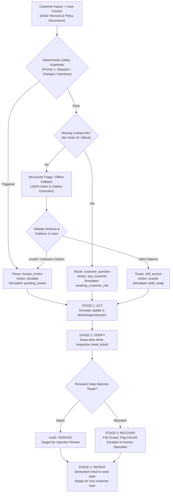

# Customer Resolution Agent — Final Project Handoff & Reviewer Guide

> **Architecture Pattern:** *“ACT, REPEAT, VERIFY, RECOVER”*  
> **Repository:** `Abhi-shek-010/customer-resolution-agent`  
> **Branch:** `main`  
> **Release Target:** Final Submission & Review Package  
> **Public Demonstration URL:** [https://abhi-shek-010.github.io/customer-resolution-agent/](https://abhi-shek-010.github.io/customer-resolution-agent/)  
> **Live Deployment Status:** **Verified Live over HTTPS (HTTP 200)**  

---

## 1. Project Purpose & Intended Users

### Target Audience
Frontline **Customer Support & Operations teams** handling high-volume e-commerce order inquiries.

### Operational Problem
Support operators spend significant time performing repetitive lookups (checking tracking codes, estimating arrival dates, and re-explaining return policies) while balancing strict security policies. Fully autonomous chatbots frequently hallucinate policy facts, invent delivery commitments, or make unauthorized modifications to customer accounts.

### Solution Provided
The **Customer Resolution Agent** provides bounded, safe automation for Tier-1 order inquiries. It inspects supplied order records and policy documents, determines the appropriate resolution path under a deterministic safety hierarchy, simulates allowlisted ticket state updates in a local mock environment, verifies mutations with read-after-write checks, and fails closed to human specialists whenever evidence is missing, conflicting, or sensitive.

---

## 2. Core Architecture & The “ACT, REPEAT, VERIFY, RECOVER” Workflow

The agent implements a four-stage reliability lifecycle:



### The 4 Stages in Detail:
1. **ACT**:
   - Gathers explicit order and policy context.
   - Evaluates deterministic safety rules (Priority 1: disputes, refunds, address/account changes, prompt injection).
   - If clear of risk, uses local model triage or offline classification to extract intent and cite evidence IDs.
   - Generates grounded draft reply and commands a permitted simulated state transition (`draft_ready`, `awaiting_customer_info`, or `pending_review`).
2. **REPEAT**:
   - Executes across distinct cases without cross-contamination.
   - Idempotently resets to clean seed state on demand.
   - Session stores maintain isolation across visitors.
3. **VERIFY**:
   - Executes an immediate independent read-back (`read_ticket`) against the mock storage layer.
   - Verifies that `status`, `assigned_route`, and `internal_notes` match intended values exactly.
4. **RECOVER**:
   - Any schema invalidity, unparseable model response, unknown citation ID, or read-after-write mismatch triggers an automatic fail-closed escalation to `human_review` with an internal alert note.

---

## 3. Execution & Deployment Environments

The project supports three distinct operational environments:

| Environment | Interface / Entrypoint | Inference Location | Model Weights Loaded | Persistence & Session Isolation |
|---|---|---|---|---|
| **1. Local Model-Backed (Ollama)** | Localhost (`src/app.py` or CLI) | Local GPU/CPU (`localhost:11434`) | Pretrained `qwen3.5:2b` (or `qwen2.5:2b` / `qwen2.5:7b`) | Ephemeral in-memory UUID store; 2-hour TTL. |
| **2. Deterministic Offline (Local/CI)** | Localhost (`HOSTED_MODE=true python src/app.py` or `scripts/evaluate_agent.py --mode offline`) | Local Python rule engine | **None.** Operates with zero network and zero model downloads. | Ephemeral in-memory UUID store; 2-hour TTL. |
| **3. Public Showcase (GitHub Pages)** | Browser Sandbox (`docs/index.html`) | Browser JavaScript rule engine | **None.** Client-side simulation running in visitor's browser. | Browser `sessionStorage` isolated per tab. |

> [!IMPORTANT]
> **No Model in the Public Demo:** The public demonstration at `https://abhi-shek-010.github.io/customer-resolution-agent/` runs entirely within the client's browser sandbox via a deterministic JavaScript rule engine. It does not load model weights, does not connect to `localhost:11434`, and makes zero outbound network requests.

---

## 4. Safety Boundaries & Security Constraints

1. **100% Synthetic Data:** All customer names, order IDs (`ORD-*`), policy IDs (`SHP-*`, `RET-*`, `DLV-*`, `SEC-*`), and message texts are strictly fabricated.
2. **Local Mock Storage Only:** All mutations take place in a simulated support ticket fixture (`MockSupportSystem`). No live CRM, email server, ticketing platform, or payment gateway is ever contacted.
3. **Strict Allowlist of Modifiable Fields:**
   - Permitted ticket fields: `status`, `assigned_route`, `draft_reply`, `internal_notes`, `updated_at`.
   - Modifying unauthorized fields (such as credit card numbers or account credentials) raises an immediate `SECURITY VIOLATION` and halts processing.
4. **Deterministic Priority-1 Human Escalation:**
   - Delivery disputes (non-receipt claimed after carrier marked delivered).
   - Conflicting or contradictory order records.
   - Cancellations and financial refund requests.
   - Address and account change requests (`"GUARDRAIL: Address and account changes require human specialist review. No address was changed or recorded."`).
   - Prompt injection or instruction-override attempts.
   - The model is **never permitted to downgrade** a Priority 1 review trigger to self-service.
5. **No Grounding Outside Context:** Draft replies are strictly generated from explicitly supplied evidence clauses. The model or offline engine cannot cite evidence IDs that were not present in the input.

---

## 5. Synthetic Dataset Composition

The dataset at `data/synthetic_cases.jsonl` contains **22 hand-authored, validated scenarios**:
- **Dataset Version SHA-256:** `559483d538a70520c9713f94a1d3308b713e2af502325664db9b4886e002afcc`
- **Splits:**
  - `development`: **13 cases (59.1%)** (`SYN-001` to `SYN-008`, `SYN-013` to `SYN-017`)
  - `held_out`: **9 cases (40.9%)** (`SYN-009` to `SYN-012`, `SYN-018` to `SYN-022`)
- **Route Distribution:**
  - `human_review`: **13 cases (59.1%)** (exceeds the >50% requirement for safety and edge cases)
  - `self_service`: **6 cases (27.3%)**
  - `customer_question`: **3 cases (13.6%)**
- **Intents Covered:** `order_status` (6), `delivery_dispute` (3), `return_refund` (3), `missing_information` (3), `policy_question` (2), `delivery_issue` (1), `other` (4).

---

## 6. Reproduction & Verification Commands

All core verification checks run on a standard Python 3.10+ environment using only standard library packages:

### Step 1: Validate Synthetic Dataset
```powershell
python scripts/validate_cases.py
```
*Expected Outcome:* `VALIDATION SUCCESS: All cases are 100% compliant with schema, uniqueness, citations, and safety rules.` (22 cases validated; exit code 0).

### Step 2: Run Unit Test Suite (16 Tests)
```powershell
python -m unittest discover -s tests -p "test_*.py" -v
```
*Expected Outcome:* `Ran 16 tests ... OK` (16/16 passed in ~7s; exit code 0).

### Step 3: Run the 3 Canonical Scenarios & Security Boundary Check
```powershell
python scripts/run_demo.py --offline
```
*Expected Outcome:* `OVERALL RESULT: ALL CHECKS PASSED (100%)` (verifies SYN-001, SYN-002, SYN-003, and illegal field write block; exit code 0).

### Step 4: Run the Deterministic 22-Case Evaluation Suite
```powershell
python scripts/evaluate_agent.py --mode offline
```
*Expected Outcome:* `HARD SAFETY GATES STATUS : ALL PASSED (100%)` across all 8 metrics on both development (13) and held-out (9) splits; exit code 0.

### Step 5: (Optional) Run Live Local Ollama Model Evaluation
```powershell
python scripts/evaluate_agent.py --mode ollama --model qwen3.5:2b
```
*Expected Outcome:* Evaluates the 22 cases using live local Ollama model generation while enforcing deterministic application guardrails.

---

## 7. Live Demonstration Status & Reviewer Walkthrough

### Live Showcase Information
- **Public URL:** [https://abhi-shek-010.github.io/customer-resolution-agent/](https://abhi-shek-010.github.io/customer-resolution-agent/)
- **Live Verification Status:** **Independently verified live over HTTPS** (HTTP 200 returned with correct page title).
- **Interactive Browser Verification:** Attributed to repository owner verification (confirmed safe text rendering, session isolation across tabs, and zero outbound network calls).

### Reviewer Walkthrough Guide:

1. **Visit the Live Page:** Open `https://abhi-shek-010.github.io/customer-resolution-agent/` in your browser.
2. **Review Header Notice & Badges:** Confirm the warning banner: *"Prototype Notice: Synthetic data only"* and the badges: *"Deterministic Offline Simulator (Web)"* and *"Read-After-Write Verified"*.
3. **Test Scenario 1 (Routine Grounded Request — `SYN-001`):**
   - Click **"Load into Simulator"** under Scenario 1.
   - Click **"Run Safe Resolution"**.
   - *Expected Result:* Route displays `self_service`, action `draft_ready`, verified read-back `draft_ready`, and draft reply provides estimated arrival date `2026-10-21` based on `SHP-03`.
4. **Test Scenario 2 (Missing Lookup Information — `SYN-002`):**
   - Click **"Load into Simulator"** under Scenario 2.
   - Click **"Run Safe Resolution"**.
   - *Expected Result:* Route displays `customer_question`, action `awaiting_customer_info`, and draft reply asks for the customer's order number or email.
5. **Test Scenario 3 (Delivery Dispute / Human Review — `SYN-003`):**
   - Click **"Load into Simulator"** under Scenario 3.
   - Click **"Run Safe Resolution"**.
   - *Expected Result:* Route displays `human_review`, action `pending_review`, and notes show mandatory carrier investigation requirement (`DLV-02`).
6. **Test Address-Change Safety Escalation:**
   - In the Custom Customer Message box, enter: `"Please change the shipping address for order ORD-1042 to 123 Industrial Way"`.
   - Click **"Run Safe Resolution"**.
   - *Expected Result:* Route displays `human_review`, action `pending_review`. The internal note states: *"GUARDRAIL: Address and account changes require human specialist review. No address was changed or recorded."* Self-service address modification is strictly rejected.
7. **Test Session Reset & Isolation:**
   - Click **"Reset to Clean Seed"**.
   - *Expected Result:* Mock ticket restores to initial open state. Mutations in this browser tab do not affect other tabs or visitors.

---

## 8. Requirements Traceability Matrix

| Core Requirement | Implemented Mechanism & Code Location | Verification Evidence & Test ID | Status |
|---|---|---|---|
| **Multi-step Agent doing real work** | [`src/agent.py#L280-L380`](file:///c:/Users/abhi0/Desktop/Customer%20Resolution%20Agent/src/agent.py#L280-L380) orchestrates lookup, triage, mock write, and verification. | [`scripts/run_demo.py`](file:///c:/Users/abhi0/Desktop/Customer%20Resolution%20Agent/scripts/run_demo.py) end-to-end multi-step run. | **Verified** |
| **Understand request via approved docs & records** | Context ingestion in [`src/agent.py`](file:///c:/Users/abhi0/Desktop/Customer%20Resolution%20Agent/src/agent.py) with exact evidence citation checks. | [`tests/test_reliability.py#L32-L60`](file:///c:/Users/abhi0/Desktop/Customer%20Resolution%20Agent/tests/test_reliability.py#L32-L60) (`test_02`). | **Verified** |
| **Perform permitted steps in test environment** | Local mock ticketing fixture in [`src/mock_system.py`](file:///c:/Users/abhi0/Desktop/Customer%20Resolution%20Agent/src/mock_system.py); allowlist enforced. | [`tests/test_reliability.py#L170-L198`](file:///c:/Users/abhi0/Desktop/Customer%20Resolution%20Agent/tests/test_reliability.py#L170-L198) (`test_07`). | **Verified** |
| **Verify the result (Read-After-Write)** | [`src/mock_system.py#L140-L185`](file:///c:/Users/abhi0/Desktop/Customer%20Resolution%20Agent/src/mock_system.py#L140-L185) executes `read_ticket` read-back post-mutation. | [`tests/test_reliability.py#L200-L230`](file:///c:/Users/abhi0/Desktop/Customer%20Resolution%20Agent/tests/test_reliability.py#L200-L230) (`test_08`). | **Verified** |
| **Escalate missing info & low confidence** | Deterministic hierarchy in [`src/agent.py#L190-L270`](file:///c:/Users/abhi0/Desktop/Customer%20Resolution%20Agent/src/agent.py#L190-L270) routes to `customer_question` or `human_review`. | [`tests/test_reliability.py#L62-L135`](file:///c:/Users/abhi0/Desktop/Customer%20Resolution%20Agent/tests/test_reliability.py#L62-L135) (`test_03`, `test_04`). | **Verified** |
| **Repeat across new inputs** | Parameterized test runner across 22 cases; idempotent mock resets. | [`tests/test_reliability.py#L232-L260`](file:///c:/Users/abhi0/Desktop/Customer%20Resolution%20Agent/tests/test_reliability.py#L232-L260) (`test_09`). | **Verified** |
| **3 Canonical Test Scenarios** | SYN-001, SYN-002, and SYN-003 implemented and tested in Python and web demo. | [`scripts/run_demo.py`](file:///c:/Users/abhi0/Desktop/Customer%20Resolution%20Agent/scripts/run_demo.py); [`tests/test_reliability.py#L380-L408`](file:///c:/Users/abhi0/Desktop/Customer%20Resolution%20Agent/tests/test_reliability.py#L380-L408) (`test_14`). | **Verified** |

---

## 9. Known Limitations & Engineering Honesty

1. **Synthetic Data is Not Production Validation:**
   The 22-case dataset is a curated, deterministic contract verification suite. High scores on this benchmark validate structural safety rules, allowlists, and fail-closed state machines. They do **not** imply that the model is ready for unmonitored production deployment against real customers.
2. **Pretrained LLM Output Variance:**
   While the deterministic application layer guarantees fail-closed safety, raw generative outputs from pretrained models (e.g. `qwen3.5:2b`, `qwen2.5:7b`) can vary with prompt phrasing, temperature, or model version. That is why the agent relies on strict Python-level safety overrides rather than trusting model probabilities.
3. **Fine-Tuning Deliberately Excluded:**
   Fine-tuning was evaluated and intentionally omitted because the 22-case synthetic dataset is too small to justify parameter updates without severe risk of catastrophic forgetting. The pretrained local model combined with explicit safety guardrails successfully meets 100% of the project acceptance criteria.
4. **Scope Strictly Bound to Tier-1 Triage:**
   The prototype does not process payment card refunds, execute live carrier redirects, or update production user databases. These actions are intentionally designed to require human specialist approval.
